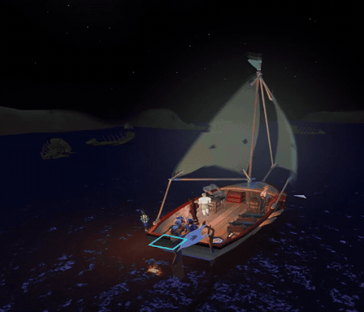
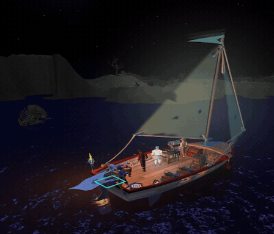
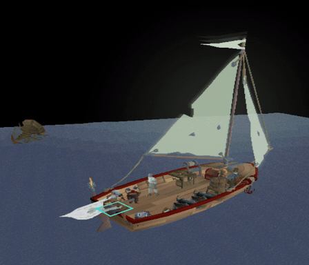
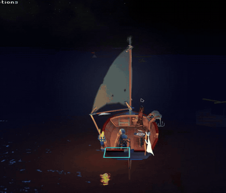
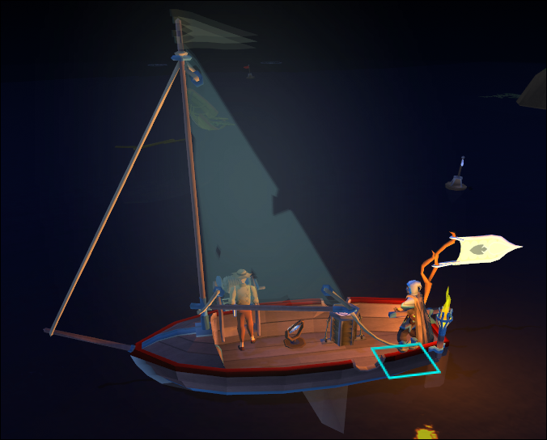

# Enhanced Ghost Sail

Makes the Sailing ghost sail look like a real ghost sail: see-through, softly glowing, and pulsing slowly.

### Off vs on

### Standard graphics (no 117 HD)

### Smaller boats too

## What it does

- **Translucent cloth.** The sail is redrawn much more see-through, so you can see the sky and water behind it.
- **Glow.** The sail is brightened and gets a soft bloom in its own colours, plus faint halo layers around the cloth.
- **Slow pulse.** The glow breathes gently over a few seconds.
- **Every ghost sail in view.** Works on your own boat, boats docked nearby and other players' boats, whether you are aboard or not.

Only sails using the ghost sail pattern are changed. Other sails are left alone.

## Settings

None. Turn the plugin on to get the effect and off to go back to the normal sail.

## Compatibility

- Built for **117 HD**, and also has its own tuned look for the standard renderer.
- Purely cosmetic. It only changes how the sail is drawn on your screen; nothing is sent to the game.

## Issues

Found a problem or have an idea? Open an issue on this repository.
